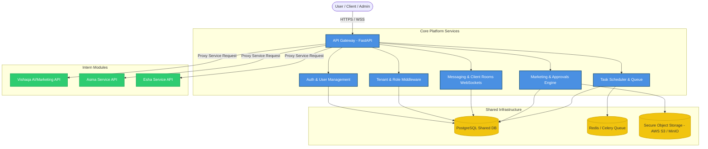
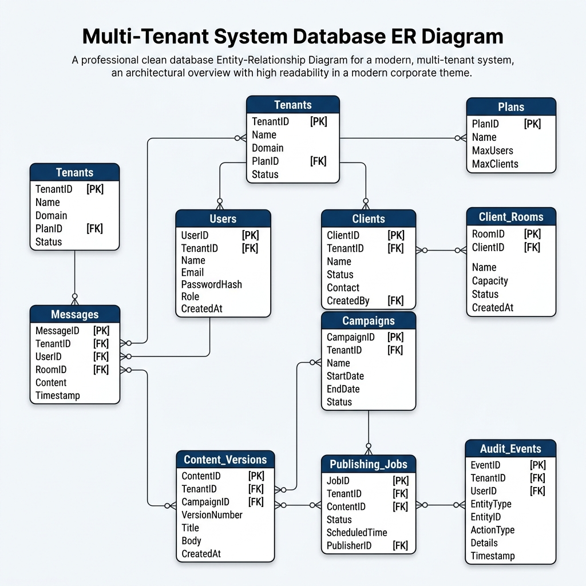
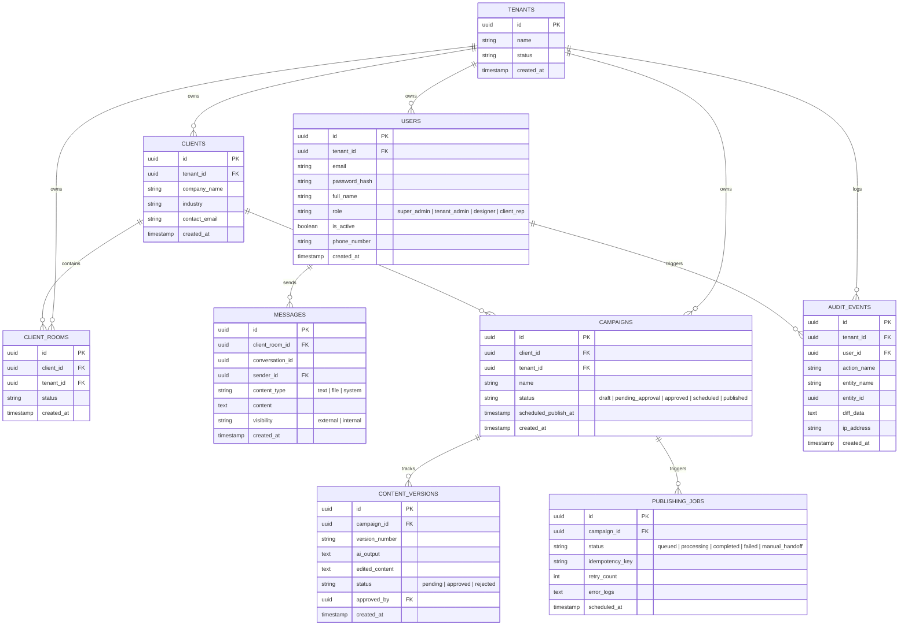

# NW Digital Operations Hub V3 - Architecture & Database ERD

This document contains the visual system architecture and the Entity Relationship Diagram (ERD) for the **NW Digital Operations Hub V3**. 

*(Note: If you are viewing this file on GitHub or in a Markdown viewer that supports Mermaid, the diagrams below will render visually. Otherwise, you can copy the code blocks below and paste them into [Mermaid Live Editor](https://mermaid.live/) to view or export them as PNG/PDF).*

---

## 1. System Architecture Diagram

This diagram shows how users connect via HTTPS/WebSockets through the API Gateway, and how requests are routed to the core services and sub-services:

### Key Architectural Layers:
1. **API Gateway (FastAPI)**: Handled on port `8000`, routes traffic, processes JWT authentication, resolves `tenant_id` from the request token, and proxies requests to individual intern services.
2. **Core Services**: Handles protected WebSocket communication (messenger/client rooms), approval state machines, and task queues.
3. **Intern Services**: Independent FastAPI services built by Vishaqa, Asma, and Esha, connected via HTTP routing through the gateway.
4. **Shared Database**: PostgreSQL with Alembic migrations, with strict tenant isolation filter rules.

---

## 2. Database ERD (Entity Relationship Diagram)

Here is a visual representation of the Entity Relationship Diagram:

This schema outlines the relationships, primary/foreign keys, and data scopes for all platform entities:

### Table Definitions & Ownership rules:
*   **Tenants & Security**: Users and Clients are strictly linked to a specific `Tenant`. No cross-tenant SQL joins are permitted.
*   **Client Rooms split**: Message visibility is categorized as `external` (clients can see it) or `internal` (only designers/admins can see it).
*   **Audit Logging**: The `AUDIT_EVENTS` table registers all actions on database entities for compliance.
